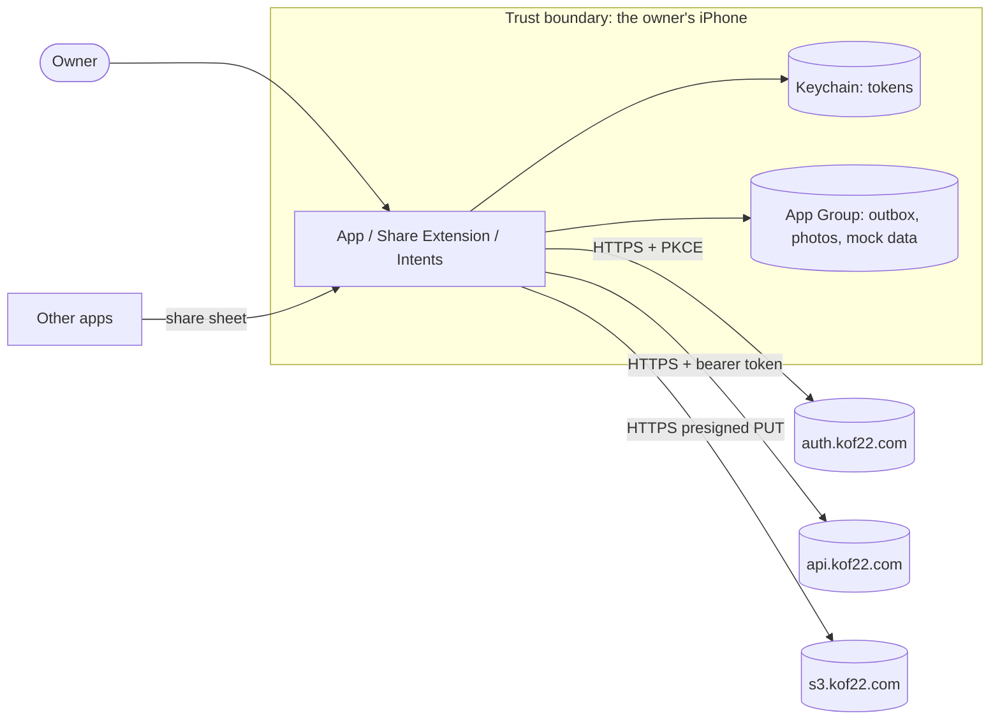

# Threat model: KoF22 Post

- **Version reviewed:** 0.1.0 (unreleased) · **Last reviewed:** 2026-10-11

## 1. What the product is and does

KoF22 Post is a personal iPhone app (with a Share Extension, widgets and App
Intents) that its owner uses to publish posts and photos to kof22.com through the
KoF22 Site API v1. It signs in with the KoF22 Authentik identity provider, keeps a
local outbox of posts waiting to be sent, and can run against an in-process mock of
the API. It has access to the user's photo library (full access, on request), precise
location (when in use, on request), the camera, and an App Group container shared
with its extensions.

## 2. Actors and components

| Actor or component | Description | Trust level |
| --- | --- | --- |
| Owner | The single user, signed in with their KoF22 account | Trusted for their own data |
| App, Share Extension, widgets, App Intents | Same developer team, share an App Group and a Keychain access group | Trusted |
| Content shared into the extension | Text, URLs and images from other apps | Untrusted |
| KoF22 Site API (`api.kof22.com`) | Authoring endpoints, presigned upload URLs, link previews | Semi-trusted (TLS, owner-operated) |
| Authentik (`auth.kof22.com`) | OAuth2 authorization server | Semi-trusted (TLS, owner-operated) |
| Object storage (`s3.kof22.com`) | Receives photo uploads through presigned URLs | Semi-trusted |

## 3. Data flow and trust boundaries

## 4. External interfaces

| Interface | Direction | Data | Authenticated? | Validated where? |
| --- | --- | --- | --- | --- |
| Authentik authorize/token/revoke | Out/In | PKCE code, tokens | Public client + PKCE; `state` checked | `OAuthClient` (state, error, missing code) |
| Site API `/v1/me/*` | Out/In | Posts, tags, photos metadata | Bearer JWT (`kof22:publish`) | Generated client decodes typed JSON; `ErrorEnvelopeMiddleware` maps errors |
| Presigned upload URL | Out | Photo bytes | Signature in URL (15 min) | Server sniffs and sanitizes the file |
| Custom URL scheme `com.kof22.post://` | In | OAuth callback, `compose`/`outbox`/`posts`/`settings` routes | No | `AppModel.open(url:)` accepts only known hosts; compose text is placed in the editor, never sent automatically |
| Share Extension input | In | Text, URLs, images | No | Images copied as files; URLs must be http(s) to be previewed; nothing is sent without the owner tapping Post |
| App Intent "Post to Field Notes" | In | Text, link, photos, tags | Device unlock / Siri | `PostComposition.validationMessage` before queueing |
| Photo library, camera, location | In | Images (with metadata), place label | iOS permission prompts | GPS stripped unless the post opts in |
| Unified log (`os.Logger`) | Out | Diagnostics | n/a | No tokens or post content are logged |

## 5. Assets

- OAuth refresh and access tokens (publish rights to kof22.com).
- Unpublished drafts and queued posts, including photos.
- Photo location metadata and the owner's current location.
- The integrity of what appears on kof22.com under the owner's name.

## 6. Threats (STRIDE)

| # | Boundary / component | Category | Threat | Likelihood | Impact | Mitigation | Status |
| --- | --- | --- | --- | --- | --- | --- | --- |
| T1 | OAuth redirect | Spoofing | Another app registers `com.kof22.post://` to capture the code | Low | High | PKCE (S256) makes a stolen code useless; `state` checked; `ASWebAuthenticationSession` delivers the callback only to this app | Mitigated |
| T2 | Tokens at rest | Information disclosure | Tokens read from disk or backups | Low | High | Keychain only, `AfterFirstUnlockThisDeviceOnly`, never logged (K22-SEC-71) | Mitigated |
| T3 | Outbox retries | Tampering / integrity | A retry after a lost response publishes twice | Medium | Medium | Idempotency keys per item and per photo; tests cover lost responses | Mitigated |
| T4 | Edits | Tampering | An offline edit overwrites a newer web edit | Medium | Medium | `If-Match` on every edit; 412 becomes an explicit overwrite decision | Mitigated |
| T5 | Photos | Information disclosure | GPS location published with a photo | Medium | High | GPS removed on device unless the post opts in; server strips EXIF again | Mitigated |
| T6 | Share Extension / URL scheme | Tampering | Shared or linked content triggers a post without consent | Low | Medium | Input only pre-fills the composer; posting needs an explicit tap or a user-run Shortcut | Mitigated |
| T7 | Link preview | Information disclosure / SSRF | A link makes something fetch an internal URL | Low | Medium | The server fetches previews with its SSRF guard (public IPs only); the app never fetches arbitrary URLs itself | Mitigated (server) |
| T8 | Network | Information disclosure | Traffic interception | Low | High | HTTPS only (ATS defaults, no exceptions) | Mitigated |
| T9 | Lost device | Elevation of privilege | Someone with the unlocked phone posts | Low | Medium | Device passcode; sign-out revokes tokens; tokens can be revoked in Authentik | Accepted |
| T10 | Dependencies | Tampering | A compromised Swift package | Low | High | Exact pins and `Package.resolved`; Dependabot with cooldown; Trivy/OSV in CI | Mitigated |

## 7. Accepted risks

- T9: a person with the unlocked phone can post as the owner. Accepted by James Maes
  (single-user personal app); mitigated by revocation in Authentik.
- Mock mode stores posts and photos unencrypted (beyond iOS data protection) in the
  App Group container; it never leaves the device.

## 8. Review log

| Date | Version | Reviewer | Changes |
| --- | --- | --- | --- |
| 2026-10-11 | 0.1.0 | James Maes (with Claude Opus 5.5) | Initial model |
